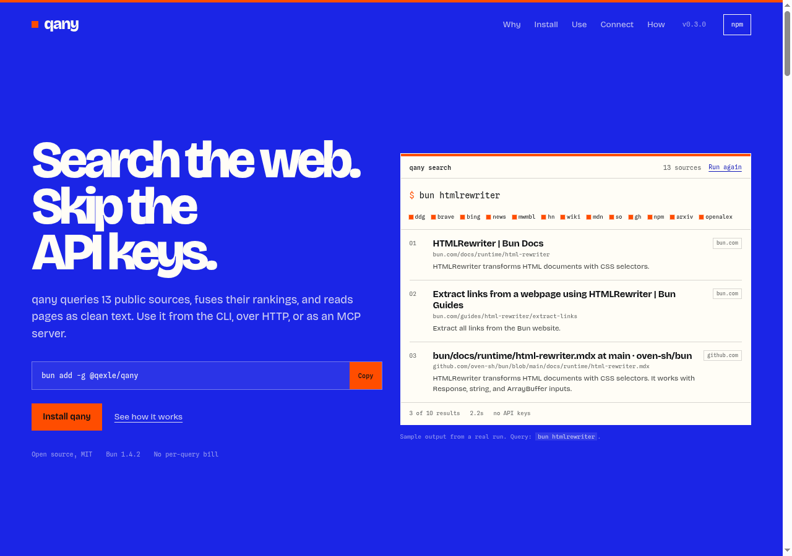
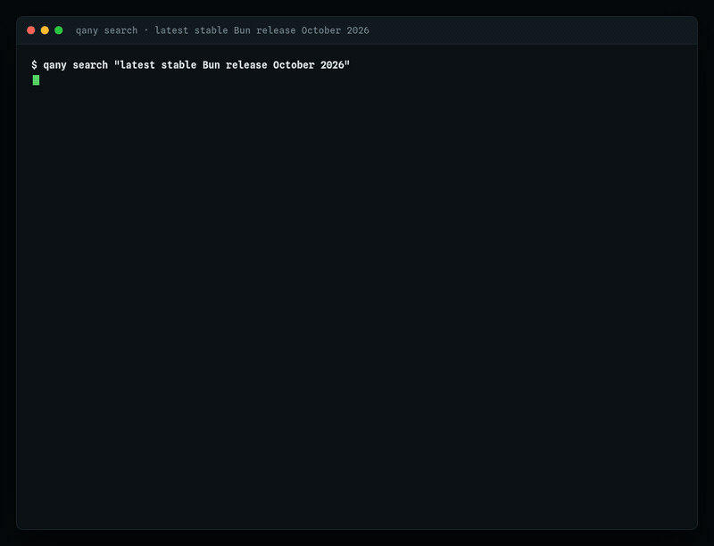

# qany

<p align="center">
  
</p>

<p align="center">
  <a href="https://www.npmjs.com/package/@qexle/qany"></a>
  <a href="https://www.npmjs.com/package/@qexle/qany"></a>
  
  
  
</p>

<p align="center">
  <code>bunx @qexle/qany search "your question"</code>
</p>

Keyless web search and page reading for LLM agents. Fourteen public sources behind one command.

An agent asks a question. qany queries DuckDuckGo, Brave, Bing, Mwmbl, Right Dao, Hacker News, Wikipedia, MDN, Stack Overflow, GitHub, npm, arXiv, OpenAlex and the Bing News feed. It fuses the fourteen rankings, reads the pages that look relevant, and returns the ones that answer the question. The same binary serves a CLI, an HTTP API and an MCP server.

## Why it earns a place in your agent

- **Fourteen sources, one ranking.** Reciprocal Rank Fusion plus a relevance vote. A page several engines agree on outranks a page one engine liked.
- **Fresh dates win the tie.** qany reads dates out of titles, snippets and URL paths. A release from eleven days ago outranks a search-index entry about the same release from six months ago.
- **It reads pages before it ranks them.** A question-shaped search fetches the top pages and reorders them by how well each page backs the question.
- **Your reading history counts.** Every page qany reads joins a local BM25 index, and later searches weigh that index as one signal.
- **Free, with no account.** The engines are public endpoints. The cache and the corpus stay in `~/.cache/qany`.

## Try it

```sh
bunx @qexle/qany search "latest stable Bun release October 2026" -n 4
```

<p align="center">
  
</p>

That is a real run, recorded while two of the fourteen engines timed out. The reply still
lands on the October release, because qany reads the date out of each result and lets the
freshest one win.

Real output, captured from a cold run with no cache:

```
1. Bun bun-v1.4.3 Release Notes & Changelog | GitWatchman
   https://www.gitwatchman.com/track/oven-sh/bun
   Bun bun-v1.4.3 is the latest release (Oct 10, 2026). Browse release notes for every version and get free alerts for new Bun releases.
2. Bun Release Notes & Changelog · October 2026 — Release Notes Index
   https://releases.sh/bun
   Every Bun release note, changelog, and product update across all tracked sources — version history refreshed October 2026.
3. bun on NPM | Release Alert
   https://releasealert.dev/npmjs/_/bun
   Latest releases for bun on NPM. Latest version: 1.4.3-canary.20261013.1, last published: October 13, 2026
4. oven-sh/bun on GitHub | Release Alert
   https://releasealert.dev/github/oven-sh/bun
   Latest releases for oven-sh/bun on GitHub. Latest version: bun-v1.4.3, last published: October 10, 2026
```

Text output stays compact: three lines per result, snippets capped at 200 characters. On the machine where I measured these numbers, a cold search took 1.8s to 13.2s depending on the query, and a warm repeat answered in 51ms.

## When not to use it

- You need sub-second latency or an SLA.
- You run high query volume or pool IPs.
- You need semantic search over a curated index. A paid API beats qany on vague or invented-word queries.
- You need compliance guarantees. Queries go to public search engines; the cache and corpus stay local.

## Install

Requires [Bun](https://bun.com) (built and tested on 1.4.2). qany parses HTML with Bun's `HTMLRewriter` and serves its HTTP API with `Bun.serve`.

```sh
bunx @qexle/qany search "bun htmlrewriter"
bunx @qexle/qany fetch https://bun.com/docs/runtime
```

To keep the command around:

```sh
bun add -g @qexle/qany
qany search "bun htmlrewriter"
```

Bun puts global binaries in `~/.bun/bin`; add that directory to `PATH` if `qany` is not found.

### From source

```sh
bun install
bun run src/cli.ts search "bun htmlrewriter"
bun run src/cli.ts fetch https://bun.com/docs/runtime
```

<details>
<summary><strong>A real search output</strong>, with snippets trimmed for readability</summary>

```
1. HTMLRewriter | Bun Docs
   https://bun.com/docs/runtime/html-rewriter
   HTMLRewriter transforms HTML documents with CSS selectors.

2. Extract links from a webpage using HTMLRewriter | Bun Guides
   https://bun.com/guides/html-rewriter/extract-links
   Extract all links from the Bun website.

3. bun/docs/runtime/html-rewriter.mdx at main · oven-sh/bun
   https://github.com/oven-sh/bun/blob/main/docs/runtime/html-rewriter.mdx
   HTMLRewriter transforms HTML documents with CSS selectors. It works with Response, string, and ArrayBuffer inputs. Bun's implementation is based on Cloudflare's lol-html.
```

</details>

## CLI

```sh
qany search <query> [-n <num>] [--json] [--no-cache] [--rerank]
qany more <url> [-n <num>] [--json] [--no-cache]
qany recall <query> [-n <num>] [--json]
qany fetch <url> [--max-chars <num>] [--json] [--no-cache]
qany serve [-p <port>]
qany mcp
qany help
```

| Command  | What it does                                                    | Defaults           |
| -------- | --------------------------------------------------------------- | ------------------ |
| `search` | Search 14 public sources and rank the merged results            | 8 results (max 20) |
| `more`   | Find pages like a URL you liked (web search seeded by the page) | 8 results          |
| `recall` | Search only your local reading corpus                           | 8 results          |
| `fetch`  | Read a page as text                                             | 20000 char cap     |
| `serve`  | HTTP API, localhost only                                        | port 8787          |
| `mcp`    | MCP server on stdio                                             |                    |

`--json` prints one line of JSON. `--no-cache` skips the search cache. Question-shaped searches rerank automatically; pass `--rerank` to verify pages on every query.

- `qany more <url>` fetches the page, extracts its distinctive terms, and runs a web search with them.
- `qany recall <query>` searches only the pages qany read before on this machine.
- Question-shaped searches decompose into keyword variants. Queries with known vocabulary gaps ("throttling" against "rate limiting") run an enriched variant alongside.
- When every engine returns nothing, qany retries with DuckDuckGo's autocomplete suggestion, gated on the suggestion keeping the query's vocabulary.

Set `QANY_CACHE_DIR` to move the cache, `QANY_NO_CACHE=1` to disable it, and `QANY_NO_LEARN=1` to stop recording pages in the local corpus. When every engine times out at once, qany re-asks them once before trying anything else.

## MCP setup

qany speaks MCP over stdio, so any MCP client can use it. Pin the version so a client keeps working when a new release lands.

Running from a checkout instead of npm? Replace `bunx @qexle/qany@0.3.0` with `bun /absolute/path/to/qany/src/cli.ts` in any command below, and use `bun` with `["/absolute/path/to/qany/src/cli.ts", "mcp"]` in the JSON configs.

### Claude Code

```sh
claude mcp add --transport stdio qany -- bunx @qexle/qany@0.3.0 mcp
```

Add `--scope user` to enable qany for all your projects, or `--scope project` to write `.mcp.json` into the current project. The default scope covers this project only.

Or write `.mcp.json` by hand:

```json
{
  "mcpServers": {
    "qany": {
      "command": "bunx",
      "args": ["@qexle/qany@0.3.0", "mcp"]
    }
  }
}
```

Then ask Claude for something current. It calls qany's `search`, `more`, `recall` and `fetch` tools on its own.

### OpenCode

```sh
opencode mcp add qany -- bunx @qexle/qany@0.3.0 mcp
```

Or add it to `opencode.jsonc` (global or project):

```jsonc
{
  "$schema": "https://opencode.ai/config.json",
  "mcp": {
    "servers": {
      "qany": {
        "type": "local",
        "command": ["bunx", "@qexle/qany@0.3.0", "mcp"],
        "enabled": true,
      },
    },
  },
}
```

OpenCode's `protocol` option defaults to `legacy` and also accepts `auto` (probe with `server/discover`) or `2026-07-28`. qany answers all three; each mode connects against OpenCode 2.0.32.

### Claude Desktop

Open Settings, go to Developer, click Edit Config, and add qany to `claude_desktop_config.json`:

```json
{
  "mcpServers": {
    "qany": {
      "command": "bunx",
      "args": ["@qexle/qany@0.3.0", "mcp"]
    }
  }
}
```

Restart Claude Desktop after saving.

### Any MCP client

Spawn `bunx @qexle/qany@0.3.0 mcp` and speak newline-delimited JSON-RPC 2.0 on stdin and stdout. qany implements:

- `tools/list`: `search`, `more`, `recall` and `fetch`
- `tools/call`: `search {query, num?}`, `more {url, num?}`, `recall {query, num?}`, `fetch {url, max_chars?}`
- `server/discover` (MCP 2026-07-28)
- `initialize` (legacy handshake)

qany writes one JSON object per line to stdout and logs to stderr. It skips malformed input lines with a stderr note.

### HTTP API

```sh
qany serve -p 8787
```

Search:

```sh
curl "http://localhost:8787/search?q=bun+htmlrewriter"
curl "http://localhost:8787/search?q=bun+htmlrewriter&n=5&format=json"
```

Fetch:

```sh
curl "http://localhost:8787/fetch?url=https://example.com"
curl "http://localhost:8787/fetch?url=https://example.com&max_chars=4000&format=json"
```

The server binds to 127.0.0.1, so it answers only requests from this machine. It responds with `text/plain` by default and `application/json` when `format=json`, returns 400 for missing parameters, and 502 with the reason when an engine or the fetch fails.

## Agent skill

The package ships a skill at `skills/qany/SKILL.md`, so an agent that already knows how to use skills can read a short guide instead of the whole README. It names the commands, the order to use them in, and the rules that keep the answers honest.

```bash
npx skills add 1QEXLE/qany
```

The npm route works without a GitHub repository: `npm i @qexle/qany` and then `npx skills experimental_sync -y` reads the skill from `node_modules/@qexle/qany/skills/qany/SKILL.md`.

## Tradeoffs

qany stays free and keyless by reading public endpoints, and those endpoints throttle. DuckDuckGo and Brave sometimes serve challenge pages; qany benches the challenged engine and uses the cache and the Wayback fallback to cover part of what throttling takes away. GitHub's repository search allows 10 requests a minute per IP, so that engine checks the cache first and waits between requests.

Run qany from one machine; do not pool IPs. Queries go to public search engines. Cached pages and the reading corpus stay in `~/.cache/qany`.

qany is at v0.3.0. The CLI and MCP interfaces may change before 1.0.

## Measured

`eval/` asks twelve developer questions and checks whether the official documentation page lands in the top three. The rule is a host plus a path prefix, so a page on the right site with the wrong page does not count. The same rule grades a single engine run through the same code path, which keeps the comparison fair.

The run below happened on 21 October 2026 on a Linux workstation.

| Run                    | Top three hits | Distinct domains per answer | Average time |
| ---------------------- | -------------- | --------------------------- | ------------ |
| qany, fourteen engines | 3 of 12        | 2.3                         | 7.5s         |
| Right Dao alone        | 3 of 12        | 2.6                         | 1.0s         |
| Bing alone             | 0 of 12        | 2.5                         | 0.8s         |

Throttling explains the numbers above. On that machine DuckDuckGo answered with a challenge page, Brave answered 429, and Bing answered with pages about football clubs and phone logins. Brave, Hacker News, MDN, Stack Overflow and npm were benched for ten minutes in every one of the twelve queries, and on the first query all twelve engines failed and the answer came back empty. A run on a healthy network scores higher, and a run on a worse network scores lower.

Two misses came close. The Rust async book came back on rust-lang.github.io rather than doc.rust-lang.org, and the Node release schedule came back on nodejs.dev rather than nodejs.org. Both were the right answer on a different address.

Reproduce the run:

```bash
bun run eval
```

Each run writes a JSON file to `eval/results/` with the hits, the timing, and, for every query, the engines that failed, were benched, or served a challenge.

## How it works

### Engines and fusion

qany queries fourteen engines: DuckDuckGo (HTML endpoint), Brave (HTML endpoint), Mwmbl (community web index), Right Dao (independent web index), Bing (RSS output), Bing News (RSS output), Hacker News (Algolia API), Wikipedia (MediaWiki API), MDN (search API), Stack Overflow (Stack Exchange API), GitHub repository search, npm registry search, arXiv (Atom API), and OpenAlex (works API).

qany dedupes results by normalized URL and fuses the engine rankings with Reciprocal Rank Fusion. A URL returned by several engines outranks one found by a single engine. Query-word overlap in the title, URL and snippet counts as another ranking, which keeps specific results above generic ones. Local corpus reads count as another ranking. A domain-trust table built from past rerank verdicts nudges near-ties toward sources that keep verifying.

Freshness joins the same tie-breaking band. qany reads dates out of titles, snippets, URL paths ("2026/10/18") and relative forms ("3 hours ago"); items from the last 14 days rise, items older than a year sink, and pages with no readable date stay untouched. The date signal keeps the newest release above a search-index entry for a version that shipped months ago.

qany weighs each engine by the query's intent. A dev question ranks docs, repos and Stack Overflow above the paper indexes. A news or current-events query ranks the news list first and sinks the academic and wiki lists. Government, military and academic domains get a small authority bump that wins near-ties against press and community pages. For news-shaped queries whose pool lacks official pages, qany also asks the news index for government, EU and international institution pages under a `site:` filter.

The query-overlap vote is rarity-weighted. The rarest word in the query carries the most weight, and qany discounts pages that miss it, so generic word overlap cannot outvote the token that names the topic.

### Relevance guard

When the top three results from an engine share no word of three or more characters with the query, qany drops that engine's set for the request. The guard catches engines that answer scripted clients with challenge pages.

### Variants and reranking

qany splits plain-language questions into up to three reading angles: a keyword topic, a quoted phrase from the longest content run, and a title-style guess. Six engines search every angle before fusion, so wording that only appears in page titles still gets a vote.

For question-shaped queries, qany fetches the top fused pages and reorders the list so pages whose full text answers the question come first. Pass `--rerank` to run that verification on every query. qany uses the verified pages for one more wave: it mines them for vocabulary the field uses but the query lacks ("iterators" yields "iteration"), searches again with those words on the web, repo and docs engines, and promotes any hit that passes the same page verification. For dev queries, the wave also asks GitHub for repository names ("async iterators" becomes "async iteration in:name"), which often returns proposal and spec repositories.

When a query names a known project or institution, qany pulls candidates from that site's own docs index (sitemaps, `llms.txt`, RSS), which covers Bun, Node, Next.js, React, Postgres, Kubernetes and a curated Nobel set, and verifies them like every other rerank pass. The docs index starts fetching while the engines run, so its pages are ready by the time fusion needs them.

### Politeness and cooldowns

qany serializes requests to the same host. DuckDuckGo, Brave, Bing, Bing News and Stack Overflow wait at least 1.1 seconds between requests. Hacker News, Wikipedia, MDN and OpenAlex wait 300 ms to 1 second. GitHub waits 6.1 seconds, arXiv waits 3 seconds, and Mwmbl waits 2.5 seconds. qany retries failures with jittered exponential backoff.

When DuckDuckGo or Brave serves a challenge or goes unreachable, qany benches it for 10 minutes (30 when it fails again within the half hour). The bench persists across runs in `~/.cache/qany/cooldowns.json`, so a new qany process does not retry the endpoint immediately. The same bench now covers repeated timeouts: an engine that times out twice within one search is benched too, so a dead index stops costing every later query its time budget.

### Cache

qany caches searches for 10 minutes and pages for 6 hours in `~/.cache/qany`. Set `QANY_CACHE_DIR` to move the directory or `QANY_NO_CACHE=1` to disable it. When engines fail and the cache holds an older answer, qany serves the stale entry and logs the reason to stderr. qany caches empty answers for 3 minutes, so a repeated miss does not re-hit every engine. Engine cooldowns live in the same directory and persist across runs.

### Local corpus

qany adds every page it reads to a local BM25 index at `~/.cache/qany/corpus.jsonl` (capped at 600 pages, deduped by URL). That index counts as one ranking in every future search, so pages you have read count toward topics you have studied. Set `QANY_NO_LEARN=1` to stop it from recording pages.

### Fetch

qany extracts readable text (drops scripts, styles, nav, footers) and falls back to the Wayback Machine when the live page fails, serves a challenge, or yields no text. Extraction also strips stray structural markup ("&lt;h3&gt;", "&lt;li&gt;") and site chrome ("Open the search menu", "Skip to content") that some pages ship as literal text, so titles and snippets come out clean. The `(direct)`, `(wayback)` or `(cache)` tag tells you which route answered.

## Adding an engine

Implement the `Engine` interface from `src/types.ts`:

```ts
export interface Engine {
  name: string;
  minIntervalMs: number;
  search(query: string, num: number): Promise<SearchResult[]>;
}
```

Write the parser against a saved fixture, add the engine to the list in `src/search.ts`, and the shared layer supplies politeness, retries and caching. `src/engines.ts` holds the current engines as worked examples.

## Development

```sh
bun install
bun test
bun run typecheck
```

## Website

The single-page site is `index.html` in the repo root. It covers install, commands, MCP and HTTP setup, how the ranking works, and an animated sample search. Open the file directly, or serve the repo root:

```sh
python3 -m http.server 4173
```

Then open http://localhost:4173.

## License

MIT. See [LICENSE](LICENSE).
